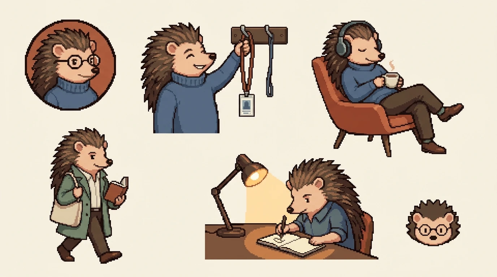
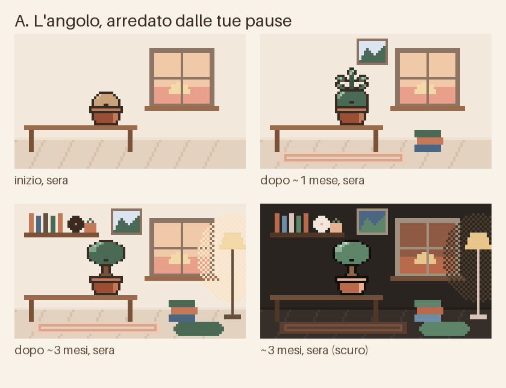
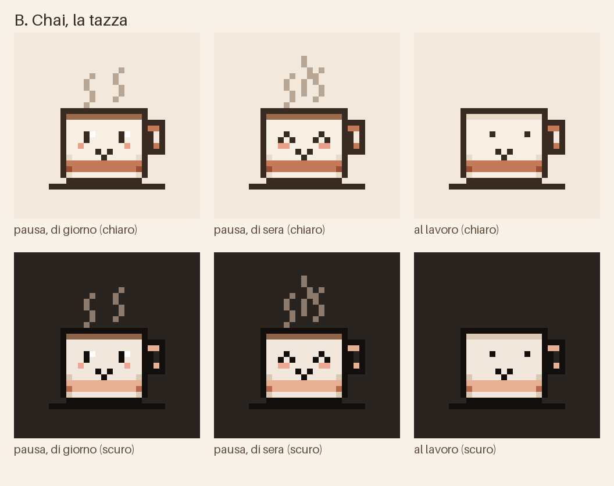
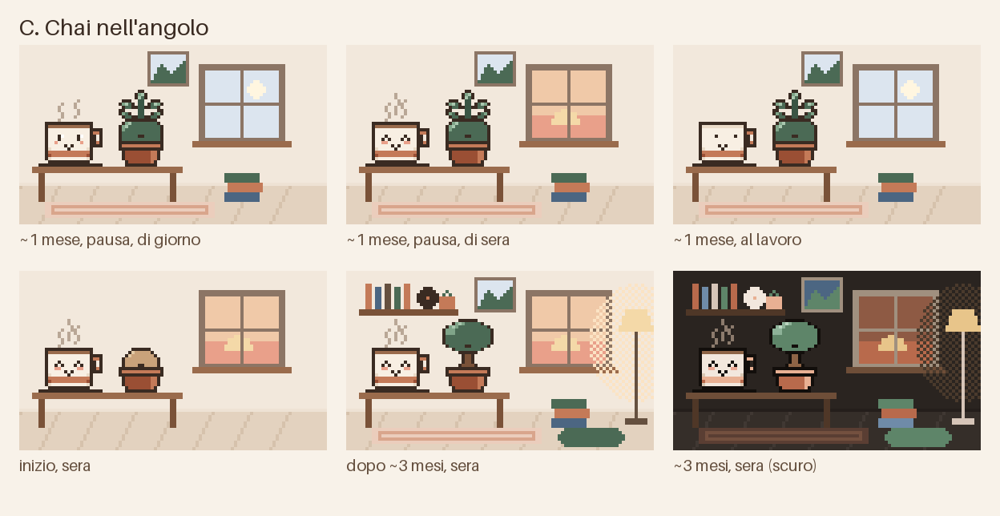

# Il personaggio di Nook

Studio per dare a Nook un personaggio suo: riconoscibile, originale, e che non metta mai ansia. Stato: **concept scelto: il riccio** (15/10/2026). Niente è ancora nell'app: il germoglio MVP (`SproutArt`, `SproutCard`, `FreeTimeLedger`) non è mai stato committato e sta in `git stash` (`stash@{0}`). Le bozze A/B/C in [`character/`](character/) sono storia, generate da `tools/character/sketch.py`, che legge `SproutArt.kt`: oggi quel file esiste solo nello stash, quindi lo script non gira sull'albero committato.

## Il riccio (concept scelto)

Concept di Antigravity/Gemini: un riccio con un dolcevita blu. Appende il badge di lavoro a un gancio (è lo "stacchi"), sta in poltrona con le cuffie e una tazza di tè, cammina con un libro e una borsa di tela, scrive il diario sotto una lampada. Il proprietario lo ridisegna in pixel art (circa 48x48), Claude lo anima. La logica di crescita e punteggio si rifà da zero attorno al riccio (non ancora progettata). Le regole e la checklist qui sotto restano valide.

Note da tenere:

- Gli occhi non devono mai sembrare chiusi o addormentati (attenzione alla posa in poltrona): vale la regola 3.
- Lampada e scrivania devono leggersi come diario, non come straordinari.
- I ricci sono notturni: lo teniamo sveglio e adatto al giorno, con luce e attività da tempo libero.
- Semplificare per il pixel art piccolo; il dolcevita blu è il segno distintivo.

## 1. L'anima

Nook esiste perché abbiamo una vita oltre il lavoro. Il personaggio deve far sentire questo, non chiedere qualcosa in cambio.

Le app di focus (Forest, Flora) premiano il tempo che dai al lavoro e puniscono chi esce dall'app. Nook fa il contrario: **premia il tempo che ti riprendi e non punisce niente.**

### Le quattro regole

1. **Non chiede mai niente.** Niente notifiche sue, niente "mi manchi", niente fame o sete da soddisfare. Non muore, non appassisce, non torna indietro.
2. **Vive quando vivi tu.** Nella pausa è attivo e fa cose da tempo libero legate all'ora e alla stagione vere (luce, stagione, pioggia e neve vengono da `ZenEnvironment`, come nelle scene).
3. **Al lavoro non soffre e non dorme.** Fa la sua vita tranquilla, senza aspettarti. Niente "zz": `MOTION.md` vieta già i personaggi che dormono, e il germoglio attuale va corretto su questo punto.
4. **Raccoglie ricordi, non punteggi.** Ogni pausa lascia una traccia che si vede (un oggetto, una foglia), non un numero da battere.

### Checklist anti-stress

Ogni idea nuova sul personaggio passa da qui. Se una risposta è "sì", l'idea va rifatta.

| Domanda | Perché |
|---|---|
| C'è una serie di giorni da non interrompere (streak)? | Una serie rotta è una piccola colpa |
| Qualcosa si perde, si rompe o peggiora se non apri l'app o lavori una sera? | La sera di lavoro capita: quella sera non cresce niente, fine |
| Un giorno senza pausa appare rosso, vuoto o "mancato"? | Va mostrato neutro |
| C'è un confronto con altre persone o con "la settimana scorsa" in percentuale? | Il tempo libero non è una gara |
| C'è un conto alla rovescia o una scadenza? | Mette fretta |
| Il personaggio manda notifiche o chiede attenzione? | Nook toglie notifiche, non ne aggiunge |
| Su Home c'è un traguardo numerico in evidenza (barra, "mancano 12 h")? | Trasforma la pausa in un obiettivo. I numeri vanno in una schermata che apri se ti va |

## 2. Forest al contrario

Copiamo le meccaniche che funzionano nelle app di focus, rovesciate sul tempo libero.

| Nelle app di focus | In Nook |
|---|---|
| Forest: l'albero cresce mentre lavori o studi; se esci dall'app muore e resta secco nella foresta | Il personaggio cresce col tempo di pausa vissuto; aprire un'app di lavoro per un'urgenza non conta contro (Nook non lo vede). "Termina la pausa" ferma solo il conteggio |
| Forest, Flora: sessioni da avviare a mano col timer | Niente da avviare: la pausa parte da sola all'orario scelto |
| Flora: in gruppo si vede chi ha fatto morire l'albero | Niente social, niente classifiche |
| Flora: gli alberi del giardino durano 7 giorni, per spingere alla costanza | Niente scade: ogni oggetto dell'angolo resta |
| Finch: l'uccellino guadagna energia completando obiettivi; nessuna punizione, ma l'enfasi sulla costanza quotidiana pesa ad alcuni utenti | Nessun obiettivo da completare: basta vivere la pausa che hai già |
| Statistiche: ore di focus al giorno, alla settimana, al mese | Statistiche del tempo tuo (sezione 3) |

Fonti: [Forest (Headway)](https://makeheadway.com/blog/forest-app-review/), [Forest (Desirability Lab)](https://desirabilitylab.com/posts/forest), [Flora (Business of Business)](https://www.businessofbusiness.com/articles/flora-focus-productivity-app-review/), [Flora (App Store)](https://apps.apple.com/app/id1225155794), [Finch (Headway)](https://makeheadway.com/blog/finch-app-review/), [Finch, critica (Vocal)](https://vocal.media/critique/the-criousity-of-the-finch-app).

Il vantaggio in più che le altre non hanno: Nook sa **quando** sei libero e **quante notifiche di lavoro** ha lasciato fuori. Il personaggio può raccontare il tempo ripreso senza chiederti di fare niente.

## 3. Statistiche al contrario

Su Home: solo il personaggio e una frase. I numeri stanno in una schermata che apri toccando l'angolo.

| Statistica | Da dove viene | Nota |
|---|---|---|
| Tempo tuo questa settimana | `FreeTimeLedger` (oggi tiene il totale e l'ultima fascia: serve lo storico per giorno, le ultime 7 o 30 fasce) | In ore intere |
| Sere libere | Fasce con almeno 1 h vissuta | Un conteggio, non una serie |
| **Ore di luce vissute in pausa** | Incrocio fra pausa vissuta e ore di sole, già calcolate per `LifeCopy` | Il dato che nessun'altra app ha: "8 h di luce tue questa settimana" |
| Notifiche di lavoro lasciate fuori | `filtered_count` per fascia | Già contato, oggi solo nella notifica della pausa e nel resoconto del mattino |

Vista della settimana: sette colonne, ogni giorno con la sua pausa. Un giorno senza pausa è un puntino neutro, mai rosso e mai vuoto con un bordo tratteggiato. Niente media, niente "meglio della settimana scorsa".

Bozza: [`mockups/character_home.svg`](mockups/character_home.svg).

## 4. Tre concept (scartati)

Storia: il proprietario ha scelto il riccio. Restano qui per ricordare cosa si è valutato; i riferimenti a Chai, all'angolo e al germoglio non valgono più.

Le bozze usano la palette dell'app (Chai chiaro, Lo-fi night scuro) e il germoglio vero, letto da `SproutArt.kt`.

### A. L'angolo

- **Chi è:** un posto, il "nook" del nome. Un tavolino, una finestra sulla luce vera del momento, il germoglio in un vaso.
- **Come cresce:** ogni pausa lunga aggiunge un oggetto (un libro, un quadretto, un tappeto, una lampada, una mensola coi dischi). Il germoglio diventa una pianta che cresce sul tavolo.
- **Al lavoro:** la stanza c'è, la luce è quella del giorno, la lampada è spenta.
- **Pro:** il nome dell'app diventa un luogo; nessun volto, nessun rischio di "tristezza".
- **Contro:** senza volto si affeziona meno; somiglia alle "stanze cozy" di molti giochi.
- **Checklist:** passa.

### B. Chai, la tazza

- **Chi è:** la tazza dell'icona che prende vita. Icona e personaggio sono la stessa cosa: chi vede l'icona sul telefono vede Chai.
- **In pausa:** il tè fuma; di giorno occhi aperti, di sera occhi contenti ad arco (contento, non addormentato).
- **Al lavoro:** sveglia e tranquilla, guarda fuori; il tè è pieno ma ancora freddo, niente fumo. Non aspetta te.
- **Come cresce:** da sola cresce poco (decori sulla tazza, una bustina di tè di stagione). È il suo limite.
- **Pro:** identità di brand fortissima, si legge anche a 24 px, nel riquadro e nella notifica.
- **Contro:** poco da collezionare.
- **Checklist:** passa.

### C. Chai nell'angolo (consigliato)

- **Chi è:** Chai abita l'angolo e lo arreda con i ricordi delle tue pause. Personaggio con un volto (B) + collezione lenta (A).
- **Riuso:** il germoglio resta, come la pianta di Chai sul tavolo (senza volto: nell'angolo il volto ce l'ha solo Chai). `FreeTimeLedger` e le soglie degli stadi restano; gli oggetti si sbloccano con le stesse ore cumulative.
- **Luce vera:** la finestra mostra la fase del giorno e la stagione (`ZenEnvironment`), quindi l'angolo cambia da solo senza animazioni continue.
- **Al lavoro:** come B. La lampada è spenta, il tè non fuma.
- **Pro:** distinto da tutte le app citate (nessuna ha un personaggio che vive *il tuo tempo libero* e non il tuo lavoro); si porta bene su icona, notifica, sito e store.
- **Contro:** più disegno (un oggetto per traguardo); la Home deve restare in una schermata, quindi l'angolo prende il posto del germoglio senza crescere in altezza (2:1 come oggi, `HomeColumn`).
- **Checklist:** passa, a patto che gli oggetti non abbiano un "prossimo oggetto a X h" in evidenza su Home.

## 5. Voce

Chai non parla in prima persona: l'app ne parla in terza persona, con le regole di "Testi e tono" in `DESIGN_SYSTEM.md`. Ogni frase dice un fatto concreto.

Bozza (riletta dall'agente `copywriter`; `{…}` sono dati reali, i conteggi vanno in `plurals`):

| Momento | IT | EN |
|---|---|---|
| Pausa, di giorno | Il tè di Chai fuma. La pausa dura fino alle {22:00}. | Chai's tea is steaming. The break lasts until {22:00}. |
| Pausa, di giorno | Fuori ci sono ancora {5 h 58 min} di luce. Chai sta alla finestra. | There are still {5 h 58 min} of daylight outside. Chai is at the window. |
| Pausa, di sera | Chai ha acceso la lampada. {12} notifiche di lavoro sono rimaste fuori. | Chai has turned the lamp on. {12} work notifications stayed outside. |
| Al lavoro | Chai guarda fuori dalla finestra. La prossima pausa inizia alle {22:00}. | Chai is looking out of the window. The next break starts at {22:00}. |
| Al lavoro | Il tè di Chai è ancora pieno. Stacchi alle {18:00}. | Chai's tea is still full. You finish at {18:00}. |
| Primo giorno | L'angolo è vuoto. Il primo oggetto arriva dopo la tua prima pausa. | The corner is empty. The first object arrives after your first break. |
| Nuovo oggetto | Dopo {9} ore di pausa, nell'angolo c'è una lampada. | After {9} hours of break, there is a lamp in the corner. |
| Nuovo oggetto | Tre sere di pausa, e da oggi sul muro c'è un quadro. | Three evenings of break, and a picture now hangs on the wall. |
| Resoconto del mattino | Questa notte l'angolo ha preso un oggetto, dopo {10 h} di pausa. | The corner got a new object overnight, after {10 h} of break. |
| Statistiche, titolo | Il tempo tuo | Time of your own |
| Tempo tuo | {14 h 20 min} tuoi questa settimana | {14 h 20 min} of your own this week |
| Sere libere | {4} sere libere su 7 | {4} free evenings out of 7 |
| Luce | {6 h 10 min} di luce vissuta in pausa | {6 h 10 min} of daylight lived on break |
| Notifiche | {38} notifiche di lavoro rimaste fuori | {38} work notifications left outside |
| Giorno senza pausa | Oggi nessuna pausa. Il conto riparte alla prossima. | No break today. The count picks up at the next one. |

Parole da non usare per Chai:
- Attesa e mancanza: "aspetta", "ti aspetta", "ti manca" (waits for you, misses you).
- Sonno e premio: "dorme", "riposa", "te lo meriti" (sleeps, rests, you earned it).
- Sentimenti e prima persona: "felice", "triste", "solo", "io" (happy, sad, lonely, I). Il volto mostra lo stato, il testo dice i fatti.

## 6. Regole visive

- Pixel art 24×24 per Chai e per il germoglio (come `SproutArt`), l'angolo su una tela 96×56 (circa 2:1, come lo spazio della scena su Home).
- Colori solo dalla palette dell'app e da `ZenPalette`, al massimo 6 per oggetto. Contorno `#3A2B22` in chiaro, `#120E0B` in scuro.
- Nessuna sfumatura: la luce della lampada è un retino a scacchi (dithering).
- Movimento: solo il fumo e un battito d'occhi, letti da `AmbientClock`. Mai un clock proprio (vedi i limiti di prestazioni in `CLAUDE.md`).
- Stati: pausa di giorno, pausa di sera, al lavoro. Mai triste, mai addormentato.

## 7. Decisioni aperte

1. ~~Quale concept (A, B o C).~~ Deciso: il riccio. Restano: nome, logica di crescita, pose e stati.
2. Il nome: "Chai" è una proposta (è anche il nome della palette chiara).
3. Gli oggetti dell'angolo e le ore che li sbloccano: si tengono le soglie del germoglio (8, 40, 120, 300 h) o servono più oggetti, più fitti?
4. La scena (`ZenScene`, `SceneCard`, `ui/zen`): con l'angolo che ha già la finestra sulla luce vera, la scena si toglie o diventa la vista fuori dalla finestra?
5. Icona del launcher: resta la tazza attuale o diventa Chai col volto?
